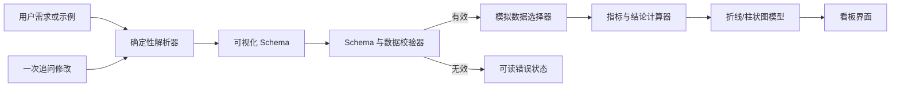
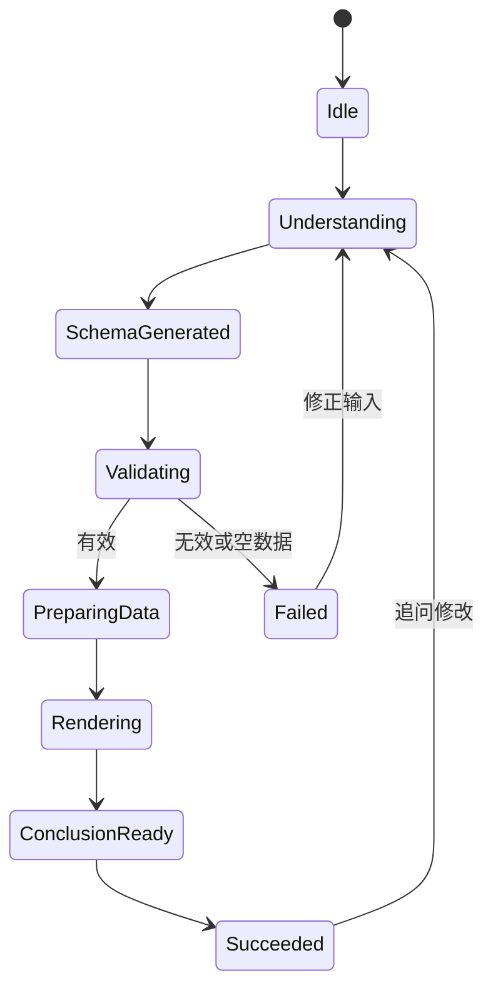

# 股票分析 Copilot 看板 - 技术计划

## 目标概述

- **目标：** 交付一个本地离线 Demo，将一句中文股票分析需求转换为经过校验的可视化 Schema，基于确定性的模拟数据渲染有用的看板，并用数据支撑的结论解释结果。
- **实现方式：** 构建一个浏览器应用，使用确定性的规则解析、仓库内固定数据集、显式 Schema 校验、有状态看板渲染和聚焦的自动化测试。
- **产品定位：** 本计划中的产品需求来自题目和已确认的产品定位：这是可解释的演示产品，不是实时交易或投顾产品。
- **执行范围：** 从空工作区开始实现代码，然后进行单元测试、集成测试、构建验证和浏览器冒烟验证。
- **停止条件：** 本次交付不加入真实行情接入、账号体系、持久化存储、投资建议或不受限制的对话记忆。

## 产品契约

### 摘要

构建一个离线股票分析 Copilot，接收一条自然语言需求，展示系统解释后的 Schema，并基于确定性数据渲染图表和简短结论。首版只支持少量股票、指标、时间范围、分析操作和一次追问修改。

### 问题背景

用户通常需要先手动选择股票、指标、日期范围、图表类型和分析动作，才能查看一个简单的股票问题。这样的配置过程无法让用户确认系统是否正确理解了需求，当结果错误时也不利于评审和排查。产品需要让理解结果可见、可修正，同时保证每次离线运行都能复现相同结果。

### 需求

**自然语言输入和示例**

- R1. 应提供一个主要的中文自然语言输入框和生成操作。
- R2. 应提供至少五条可执行示例，覆盖价格趋势、成交量、涨跌幅、排名和组合股票分析。
- R3. 在数据集不变时，重复提交相同需求应产生相同的 Schema、图表数据和结论。

**Schema 理解与校验**

- R4. 生成的 Schema 应标识股票、请求指标、时间范围、每个指标的图表类型、标题、数据来源、数据截止时间和单位。
- R5. 解析器应识别支持的股票 A、B、C，最近 10/15/20/30 个交易日，收盘价、成交量、每日涨跌幅，以及趋势、最高、最低、最大涨幅、最大跌幅和排名等分析操作。
- R6. 校验器应拒绝不支持的股票、指标、超出数据范围的时间范围、缺少必填字段的 Schema 和空结果集，并且不能导致应用崩溃。
- R7. 校验失败时应解释问题，并在适当情况下给出支持的值或修正方式。

**确定性数据和看板**

- R8. 应随项目提供固定数据集，至少包含三只股票和至少 30 个交易日的收盘价、成交量及每日涨跌幅。
- R9. 看板应根据 Schema 渲染收盘价折线图，以及成交量柱状图或每日涨跌幅柱状图。
- R10. 看板应展示当前 Schema 和足够的数据源元信息，使评审者可以将图表与选中的模拟数据对应起来。
- R11. 看板应基于筛选后的数据计算并展示至少一条简短结论，例如最大跌幅日期、极值日期或区间涨跌幅。
- R12. 如果摘要卡、极值标记或数据表能提升图表理解，可以加入这些内容，但所有附加展示都必须使用与图表相同的筛选数据。

**追问修改和过程可见性**

- R13. 首次成功生成后，应支持一次简单追问，将第二个指标从成交量改为每日涨跌幅，或将时间范围改为最近 10 个交易日。
- R14. 追问修改应保留未被修改的请求字段，重新生成 Schema、图表数据和结论，并将更新结果显示为当前视图。
- R15. 界面应展示理解需求、生成 Schema、校验 Schema/数据、准备模拟数据、渲染图表、生成结论，以及成功或失败等处理状态。

**文档和验证**

- R16. 仓库应说明启动方式、架构、Schema 字段、模拟数据定义和单位、支持的语言模式、已知限制、测试命令，以及问财 Skill Hub 的未来定位。
- R17. 仓库应包含至少五条输入到输出的示例，以及至少两个覆盖成功生成和 Schema 校验失败的自动化测试。
- R18. 仓库应保存一份可读的 Agent 对话记录，说明产品定义和技术计划的形成过程。

### 关键产品决策

- **使用确定性规则解析，而不是实时调用模型。** 这样可以保持离线运行并保证重复评审稳定；R3 和 R5 约束支持的语言范围。
- **v1 运行时只使用模拟数据。** 这样可以保证可复现，并避免依赖网络或凭据；R8 和 R16 约束相关披露。
- **将 Schema 作为可见产品界面。** Schema 是连接自然语言和图表的解释层；R4 和 R10 约束这份契约。
- **只支持一次追问修改，而不是开放式记忆。** 这样既能展示纠错能力，又不会把题目扩展成聊天平台；R13-R15 约束交互边界。
- **问财 Skill Hub 是未来适配器，而不是 v1 运行依赖。** 产品保持本地可运行，同时记录扩展方向；R16 约束产品说明。

## 技术规划契约

### 关键技术决策

- KTD1. 使用浏览器优先的 TypeScript 应用、最小本地开发服务器和适合折线图/柱状图的图表库；具体框架和库在启动阶段根据工作区可用工具确定，不额外引入后端。
- KTD2. 将解析、Schema 校验、确定性数据访问、分析计算和视图状态保持为纯函数或接近纯函数的模块，使单元测试无需浏览器即可验证核心行为。
- KTD3. 使用显式有限状态序列表达处理过程，并包含成功和失败终态；界面可以为了可读性加入动画或延迟，但底层状态必须保持确定性。
- KTD4. 将模拟数据存储为版本化仓库文件，并从同一份 fixture 定义推导每日涨跌幅，或在加载时校验每日涨跌幅，避免图表和结论不一致。
- KTD5. 将无法识别的自然语言形式转化为结构化解析错误，不得静默回退到默认 Schema。

### 高层技术设计

应用是一个单体本地 Web 页面，包含五个逻辑层：确定性 fixture、领域解析与校验、分析与图表模型派生、处理状态、展示层。各层通过 Schema 和已校验的看板模型通信；浏览器不调用外部行情 API。

处理生命周期如下：

### 假设

- 空工作区可以接受常规浏览器应用脚手架，并允许在实现阶段安装依赖。
- 实现者具备可用的本地 JavaScript 运行时和包管理器；具体命令将在 U1 创建脚手架后确认。
- 题目接受确定性规则引擎替代托管模型，前提是支持的示例和输出均有文档说明。
- 固定数据截止日期属于 fixture 契约，可以选择过去的日期以确保可复现，不要求使用当前日期。

### 依赖和约束

- 主 Demo 路径不得要求运行时联网、API Key 或问财账号。
- 选定的图表方案必须能在目标浏览器中渲染折线图和柱状图，并支持响应式布局而不改变数据模型。
- 所有面向用户的金融数据都必须明确标注为模拟数据，并明确不是投资建议。

### 实施顺序

先实施 U1，确定运行时、测试运行器和浏览器入口，再实施领域模块。U2 和 U3 必须先于 U4，因为 U4 依赖稳定的 Schema 和数据契约。成功看板路径完成后实施 U5，随后完成 U6 和 U7 的文档与端到端验证。每个功能单元完成后执行对应验证，并在交付前执行完整验证契约。

## 实现单元

### U1. 建立本地 Demo 基础

- **目标：** 创建最小浏览器应用脚手架、测试运行器、lint/类型检查/构建脚本和适合离线运行的应用入口。
- **需求：** R1、R16、R17。
- **文件：** `package.json`、`src/main.*`、`src/app.*`、`tests/setup.*`、`README.md`（初始章节）以及选定工具的配置文件。
- **模式：** 优先遵循工作区可用的运行时约定；由于当前没有既有文件，保持脚手架精简，除非需求明确要求，否则不创建后端。
- **测试场景：** 启动本地应用并确认入口页面加载；运行空测试套件并确认配置的测试命令成功退出；运行生产构建并确认生成可加载的浏览器产物。
- **验证：** 将选定的运行时和命令记录到最终 README 中；在确认脚手架的测试和构建命令前，不进入后续功能单元。

### U2. 定义确定性 fixture 和领域契约

- **目标：** 添加版本化模拟股票数据、支持的标识和指标、Schema 类型、单位元数据、数据截止日期以及纯数据选择辅助函数。
- **需求：** R4、R5、R8、R10。
- **文件：** `src/domain/schema.*`、`src/domain/data.*`、`src/data/mock-stocks.*`、`tests/domain/data.*`。
- **模式：** 保持 fixture 行显式且确定；集中管理指标元数据，避免标签、单位、默认图表和支持值错误信息不一致。
- **测试场景：** 选择 A 的最近 30 天并获得恰好 30 行；选择最近 10 天并获得末尾 10 个交易日；请求未知股票或不支持的范围并得到领域错误；验证每个支持的指标都有单位和默认图表；验证固定截止日期元数据可读。
- **验证：** 将 fixture 行数、选中日期边界和单位与数据契约进行比对；本单元不要求浏览器渲染。

### U3. 解析、校验并计算分析结果

- **目标：** 将支持的中文需求模式解析为完整 Schema，校验 Schema，计算筛选后的序列、极值和排名结果，并生成简短结论数据。
- **需求：** R3-R7、R11、R13-R14。
- **文件：** `src/domain/parser.*`、`src/domain/validator.*`、`src/domain/analysis.*`、`tests/domain/parser.*`、`tests/domain/validator.*`、`tests/domain/analysis.*`。
- **模式：** 让解析过程确定且显式支持别名；返回带类型的成功/错误结果，不让异常直接穿透 UI；所有计算都基于筛选后的行，禁止硬编码结论。
- **测试场景：** 将 A/30 天股价和成交量示例解析为预期的股票、范围、指标、图表类型、标题、来源、截止日期和单位；解析五条文档示例；应用“把成交量改成涨跌幅”并保留股票和范围；应用“改为最近 10 天”并保留股票和指标；拒绝未知指标、未知股票、缺少必填 Schema 字段、不支持的范围和空筛选数据；从 fixture 计算预期最大跌幅日期和区间涨跌幅。
- **验证：** 独立运行领域测试，精确断言 Schema 字段和结论值；增加确定性测试，比较同一输入两次运行的序列化输出。

### U4. 渲染看板和处理状态

- **目标：** 基于领域结果构建输入区、示例区、处理状态时间线、可见 Schema 面板、折线/柱状图、摘要/结论区域和可读错误状态。
- **需求：** R1-R2、R9-R12、R15。
- **文件：** `src/ui/App.*`、`src/ui/components/*`、`src/ui/state.*`、`src/ui/styles.*`、`tests/ui/dashboard.*`。
- **模式：** 让领域结果作为 Schema、图表序列、标签、单位和结论的单一数据源；显式表示加载、成功和失败状态；让图表具备响应式布局，并配合文字标签和数据明细。
- **测试场景：** 提交默认示例并在成功看板前观察按顺序出现的处理状态；确认收盘价折线图和成交量柱状图使用与 Schema 相同的日期；切换第二指标为每日涨跌幅，确认图表类型、单位、标题和结论同步更新；提交非法指标，确认出现行内错误且没有未捕获异常；确认之前的成功看板不会被标记为当前失败生成结果；验证窄屏和桌面视口下布局仍可用。
- **验证：** 使用浏览器冒烟测试或等价的 DOM 集成测试覆盖主流程和失败流程；截图审查只用于发现布局回归，不能替代领域正确性断言。

### U5. 实现一次追问交互

- **目标：** 添加追问输入或快捷操作，只转换一次当前请求并重新生成看板，且不丢失未修改字段。
- **需求：** R13-R15。
- **文件：** `src/ui/components/Followup.*`、`src/domain/parser.*`、`src/ui/state.*`、`tests/ui/followup.*`。
- **模式：** 将追问修改实现为对最近一次有效请求的受限转换；不支持的修改复用首次生成的可读错误路径；明确保留当前结果和处理历史。
- **测试场景：** 生成 A/30 天股价加成交量看板，将成交量改为每日涨跌幅，并确认股票、范围和股价指标不变；将范围改为最近 10 天，确认行数和结论改变；提交不支持的追问，确认看板稳定且错误说明支持的修改；只执行一次成功追问，确认不依赖隐藏的多轮记忆。
- **验证：** 对渲染后的 Schema 和图表标签执行浏览器集成场景，并将新结论与独立计算的 fixture 结果比较。

### U6. 完善 README、示例和 Agent 记录

- **目标：** 让候选人无需依赖历史对话即可评审和复现 Demo。
- **需求：** R16-R18。
- **文件：** `README.md`、`docs/examples/stock-analysis-examples.md`、`docs/schema/visualization-schema.example.json`、`docs/agent-conversation.md`。
- **模式：** 优先说明用户可见行为和数据口径；明确区分当前模拟数据行为与未来问财适配器；确保五条示例与可执行解析 fixture 和测试保持一致。
- **测试场景：** 按 README 从干净工作区启动 Demo；验证每条示例都能被解析器接受，或明确标记为预期错误；使用领域校验器验证提交的 Schema 示例；确认 Agent 记录包含需求澄清和产品/技术规划决策，且不包含密钥。
- **验证：** 执行干净安装或等价的可复现性检查，检查文档链接和命令，并将示例输出与自动化测试 fixture 对比。

### U7. 完成整体验证和收尾

- **目标：** 证明完整用户旅程，并在交付前移除废弃或互相矛盾的代码。
- **需求：** R3、R6-R7、R9-R15、R17。
- **文件：** `tests/integration/*`、`tests/e2e/*`、`README.md`，以及验证后修改的功能文件。
- **模式：** 使用覆盖成功、追问、非法输入、空数据和响应式渲染的最小完整测试集；使用 fixture 派生断言，不依赖截图作为唯一证据。
- **测试场景：** 从示例选择开始完成一次组合分析，直到出现结论；执行两种追问修改；执行不支持的股票、指标、范围、格式错误 Schema 和空数据路径；重复成功请求并比较序列化 Schema、图表和结论输出；在无网络条件下加载构建产物。
- **验证：** 执行格式化/类型检查/lint、单元测试、集成或浏览器测试和生产构建；检查最终 diff，确认没有死代码、调试输出、外部 API 调用或范围蔓延。

## 验证契约

U1 创建的脚手架命令是最终命令的权威来源。最终实现必须提供等价的质量门禁：

| 门禁 | 范围 | 证据 |
| --- | --- | --- |
| 格式/类型/lint 检查 | 所有源代码和测试 | 无格式、类型或 lint 错误。 |
| 领域单元测试 | U2-U3 | fixture 选择、解析、Schema 校验、确定性和计算通过。 |
| UI/集成测试 | U4-U5 | 成功流程、状态序列、追问修改、错误稳定性和图表/Schema 一致性通过。 |
| 浏览器冒烟或 E2E | U4-U7 | Demo 启动成功，在桌面和窄屏尺寸下渲染，并且无需网络即可运行。 |
| 生产构建 | U1-U7 | 构建完成并可在本地提供生成的应用。 |
| 文档审计 | U6-U7 | README 命令、示例、Schema 样例、单位、限制和 Agent 记录与实现一致。 |

浏览器界面应采用冒烟优先验证，解析和计算应采用领域单元测试优先验证。视觉检查可以发现布局问题，但不能替代对 Schema 或计算值的断言。

## 范围边界

### 后续再做

- 真实问财 Skill Hub 适配器或其他行情数据连接器。
- 实时刷新、身份认证、看板保存、分享和持久化用户历史。
- 更多股票、任意日期表达式、灵活的多股票比较和不受限制的对话记忆。
- 高级金融图表、技术指标、提醒、投资建议或风险评分。

### 不属于本产品定位

- 生产级交易、券商执行、个性化投资建议或实时金融准确性承诺。
- 支持拖拽布局或任意图表创作的通用看板搭建器。

## 风险与依赖

- **脚手架不确定性：** 工作区为空，运行时和图表包尚未选定。U1 必须先确定最小可用技术栈，后续领域单元才能依赖它。
- **解析范围膨胀：** 过于宽泛的自然语言支持会造成不确定或误导性的解释。v1 应限制在文档明确的中文模式内，超出范围时明确失败。
- **数据与结论漂移：** 重复派生数据或硬编码结论会降低看板可信度。所有图表和结论都必须从相同的筛选 fixture 行派生，并断言精确值。
- **视觉造成的错误信心：** 精美图表可能掩盖错误 Schema。必须保持 Schema、元信息和原始数据关联可见且可测试。
- **外部数据认知偏差：** 评审者可能误以为运行时必须使用问财。README 和界面应明确当前来源是固定模拟数据，外部适配器属于后续工作。

## 来源与调研

- 用户提供的题目说明，以及对话中确认的产品定义。
- 工作区中没有现有仓库代码、项目策略、领域术语表或组织经验文件；计划中的路径均为拟新增内容，不代表已有代码模式。

## 完成定义

- 本地 Demo 可按文档命令启动，并在干净安装后离线运行。
- 主示例和至少另外四条示例能生成确定且合法的 Schema 及看板。
- 看板包含折线图、柱状图、可见的 Schema/数据元信息，以及基于选中数据行计算的结论。
- 两种支持的追问修改只更新目标字段，并重新生成所有依赖展示。
- 非法 Schema、不支持的股票/指标/范围和空数据都会产生可理解且可恢复的错误，不出现未捕获异常。
- 自动化测试覆盖领域成功/失败、确定性、追问行为、UI 状态转换和主浏览器旅程。
- README、Schema 样例、五条样例输入/结果、模拟数据单位、已知限制和 Agent 对话记录完整，并与实现一致。
- 最终 diff 中不保留废弃实验、调试日志、隐藏网络依赖或范围外生产功能。
