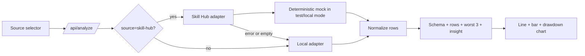

# Stock Dashboard Review Gap Remediation - Plan

## Goal Capsule

- **Objective:** Make the stock dashboard demonstrably satisfy the candidate submission rubric by providing a reproducible问财 Skill Hub path, richer visualizations, complete setup documentation, and browser-level acceptance evidence.
- **Means:** Keep the existing deterministic local dataset as the offline fallback, isolate Skill Hub access behind a verified adapter and a local mock fixture, add one genuine third chart type, and automate the critical UI journeys.
- **Stop conditions:** Do not add real trading, production-grade streaming, complex candlesticks, multi-stock comparison, drag-and-drop layouts, or unrestricted multi-turn memory.

---

## Product Contract

### Problem Frame

The dashboard already parses concrete companies, produces a validated Schema, renders a line chart and bar chart, supports follow-up changes, and passes unit/build checks. The remaining evaluation risk is evidence rather than the basic dashboard flow: the Skill Hub integration is a generic configurable HTTP adapter without a reproducible provider contract, the visualization set is only at the minimum two types, and the README/browser smoke path does not yet prove the complete submission experience.

### Requirements

#### Reproducible Skill Hub integration

- R1. The project MUST document the exact Skill Hub adapter contract used by the application, including endpoint configuration, request fields, response fields, authentication location, timeout behavior, and fallback behavior.
- R2. The project MUST include a deterministic local mock Skill Hub provider or fixture so Skill Hub success can be tested without real credentials or network access.
- R3. A Skill Hub request MUST be attempted first when the user selects问财 Skill Hub; only provider failure, timeout, malformed payload, or empty data may trigger local fallback.
- R4. The response and UI MUST distinguish requested source, resolved source, and fallback reason.

#### Richer visualization

- R5. The report MUST retain the price line chart and selected metric bar chart.
- R6. The report MUST add one genuine third visualization type, preferably a horizontal top-three drawdown chart or a daily change distribution chart.
- R7. The top three drawdown visualization MUST use the same `dashboard.worst` rows as the conclusion and existing chart markers.

#### Submission evidence

- R8. README MUST explain local startup, optional Skill Hub configuration, mock-provider testing, data semantics, supported companies, Schema fields, five example prompts, follow-up behavior, known limitations, and the exact verification commands.
- R9. The docs MUST include at least five prompt-to-result examples, a Schema example, the dataset description, and the Agent conversation record.
- R10. Browser-level smoke coverage MUST verify the source selector, successful local report, Skill Hub mock success, fallback notice, third chart, follow-up, workflow states, and recoverable invalid-input error.

### Acceptance Examples

- AE1. With local source selected, an东方财富 request produces a deterministic report with line, bar, and third chart visualizations.
- AE2. With Skill Hub selected and the mock provider enabled, the report resolves to Skill Hub and displays the normalized mock rows.
- AE3. With Skill Hub selected and the mock provider unavailable, the report resolves to local data and shows the fallback reason.
- AE4. A follow-up changing成交量 to涨跌幅 preserves the requested/resolved source and updates the bar/third chart data.
- AE5. An unsupported company, metric, range, source, or empty provider response shows an actionable error without blanking the form or crashing the page.
- AE6. A fresh developer can follow README instructions and reproduce all three source states without external market credentials.

### Scope Boundaries

- Deferred: real provider certification, provider rate-limit dashboards, caching, scheduled refresh, multi-stock comparison, export, and real-time streaming.
- Out of scope: trading execution, investment recommendations, portfolio management, and real financial claims.

---

## Planning Contract

### Key Technical Decisions

- KTD1. Treat the Skill Hub adapter as an explicit, documented contract rather than an undocumented generic POST. The contract owns the request and response mapping; tests use the same shape through a local mock.
- KTD2. Use a server-side mock mode selected by an environment variable or test-only endpoint. Browser code must never receive provider tokens, and the mock must be deterministic.
- KTD3. Add a horizontal drawdown bar chart as the third chart. It directly explains the requested top-three dates and reuses existing normalized rows, reducing data duplication.
- KTD4. Use Playwright/browser smoke coverage for visible behavior and retain pure-function tests for parsing, normalization, ranking, validation, and fallback decisions.
- KTD5. Keep the local dataset as the canonical offline fixture. Skill Hub mock rows may differ in values but must satisfy the same normalized row contract and Schema fields.

### High-Level Design

### Implementation Units

#### U1. Publish and enforce the Skill Hub contract

- **Files:** `server.js`, new server adapter/fixture module, `.env.example`, `docs/schema/visualization-schema.example.json`.
- **Work:** Define the exact provider request and normalized response shape; add bounded timeout and structured adapter errors; preserve requested/resolved/fallback metadata.
- **Tests:** valid response, HTTP error, timeout, invalid JSON, missing required fields, empty rows, and fallback result.

#### U2. Add a deterministic mock Skill Hub provider

- **Files:** new test fixture or local mock module, `tests/skillHubAdapter.test.mjs`, optional README test configuration.
- **Work:** Return stable rows for东方财富、贵州茅台、宁德时代 and the supported ranges/metrics; make failure modes selectable by test fixture.
- **Tests:** repeated calls return identical normalized rows; mock success resolves to Skill Hub; disabled mock falls back locally.

#### U3. Add the third visualization

- **Files:** `src/main.jsx`, `src/styles.css`, `src/agent.css`.
- **Work:** Add a horizontal drawdown bar chart using `dashboard.worst`, with dates, percentages, ordering, and responsive layout; keep the existing line/bar charts unchanged.
- **Tests:** chart receives the three worst rows, remains safe with fewer rows, and updates after a follow-up range change.

#### U4. Complete submission documentation and examples

- **Files:** `README.md`, `docs/natural-language-examples.md`, `docs/agent-conversation.md`, `docs/dataset.json`, `docs/schema/visualization-schema.example.json`, `.env.example`.
- **Work:** Document concrete company aliases/codes, local and mock Skill Hub startup paths, source/fallback semantics, Schema fields, five prompt/result pairs, data cutoff/units, known limitations, and test commands.
- **Tests:** documentation audit checks every required submission artifact and ensures examples match actual parser/API vocabulary.

#### U5. Add browser acceptance coverage

- **Files:** `tests/browser/stock-dashboard.spec.*` or the repository's established browser-test location, optional test configuration.
- **Work:** Start the local app with deterministic mock mode and assert visible behavior for local success, Skill Hub success, fallback, third chart, follow-up, workflow status, and invalid input.
- **Tests:** desktop and narrow viewport smoke paths; no uncaught page errors; report text and chart accessibility labels are present.

### Risks and Dependencies

- The real问财 Skill Hub protocol may change or require credentials unavailable in evaluation. The adapter contract and mock must make this limitation explicit without pretending mock data is real provider data.
- Browser tests need a stable local server lifecycle and test-only mock configuration. Keep this isolated from normal production startup.
- A third chart can create mobile overflow. Use responsive width constraints and verify at narrow viewport size.

---

## Verification Contract

| Check | Expected result |
|---|---|
| `npm test` | Existing and new parser, normalization, adapter, fallback, ranking, and session tests pass. |
| `npm run build` | Production build succeeds. |
| Mock Skill Hub contract test | Skill Hub success and all fallback/error cases are deterministic. |
| Browser smoke test | Local mode, Skill Hub mock mode, fallback, three charts, follow-up, state workflow, and invalid input all work visibly. |
| Documentation audit | README and docs contain all candidate submission artifacts and reproduce the tested commands. |

## Definition of Done

- R1-R10 are implemented and each has a passing test or documented manual verification.
- Skill Hub success is reproducible without external network access through the mock provider.
- The UI visibly identifies requested source, resolved source, and fallback reason.
- The dashboard renders line, bar, and a third chart based on the same normalized data.
- Five concrete-company examples, Schema example, dataset, Agent record, README, and tests are complete.
- Browser smoke coverage records no uncaught errors and verifies the required workflows.
- No dead mock/provider code, debug credentials, or misleading claims about real market data remain.
