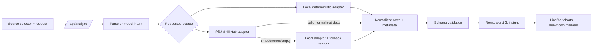

# Selectable Stock Data Sources - Plan

## Goal Capsule

- **Objective:** Users can choose whether a stock analysis uses the问财 Skill Hub or the deterministic local dataset, while receiving the same validated Schema, charts, conclusions, and recoverable errors in either mode.
- **Means:** Add a server-side data-source adapter boundary, preserve the selected and resolved source in the analysis response, and extend the existing SVG/chart and rule-engine patterns (KTD1, KTD2).
- **Authority:** Existing product requirements and the confirmed scope in this plan define user-visible behavior; the local dataset remains the offline fallback and test fixture.
- **Stop conditions:** Do not expand this work into real-time trading, multi-stock comparison, investment advice, or a Skill Hub administration console.
- **Execution profile:** Code change in the existing Node/Vite single-page application. The implementer finishes the code, tests, build, and browser smoke verification.

---

## Product Contract

### Summary

Extend the stock analysis dashboard with an explicit data-source choice. The selected source is sent with each analysis request, shown in the report, and retained through the supported follow-up interaction. Skill Hub failures fall back to local simulation with a visible explanation so the dashboard remains usable offline.

### Problem Frame

The dashboard currently produces reproducible reports from local simulated data, but the interface cannot distinguish or select an external Skill Hub source. Its Schema reserves a future Skill Hub label without representing the actual source decision, and the three largest down days are calculated but not visibly marked. Users therefore cannot control the data path or verify the requested highlight in the rendered report.

### Requirements

#### Data-source selection

- R1. The analysis form MUST provide a clear choice between问财 Skill Hub and local simulated data before a request is submitted.
- R2. Each request MUST carry the selected source to the server, and the response MUST identify both the requested source and the resolved source used to build the dashboard.
- R3. When问财 Skill Hub is selected but unavailable, unauthorized, malformed, or empty, the server MUST fall back to local simulated data and return a human-readable fallback reason without crashing the request.
- R4. Local simulated data MUST remain deterministic and usable without external credentials or network access.

#### Schema and analysis parity

- R5. Both data sources MUST produce the same validated visualization Schema contract, including stock identifier, metrics, time range, chart types, title, data source, data cutoff, and units.
- R6. Follow-up requests MUST preserve the selected/resolved source and all unchanged Schema fields while applying only the supported metric or time-range change.
- R7. Invalid source, unsupported Skill Hub payloads, invalid Schema, unsupported metrics, and empty data MUST produce understandable recoverable errors.

#### Visualization and explanation

- R8. The report MUST retain the existing line and bar charts for the selected source and keep their values consistent with the returned dashboard rows.
- R9. The three largest negative daily changes MUST be marked on the price chart and listed with date and percentage change.
- R10. The report MUST show the resolved data source, cutoff time, fallback state when applicable, and a concise conclusion derived from the same rows rendered by the charts.

### Key Decisions

- Data source choice is user-controlled and visible in the report (session-settled: user-approved — chosen over silently selecting one source: the requirement is explicitly user choice; Governs R1, R2, R10).
- Skill Hub failure falls back to local simulation with an explanation (session-settled: user-approved — chosen over failing the whole dashboard: preserves offline/reproducible usability; Governs R3, R4, R7).
- The top-three drawdowns use chart markers plus a compact ranking list rather than a third full chart (session-settled: user-approved — chosen over adding another complex visualization: satisfies verification with less layout and rendering complexity; Governs R9).

### Acceptance Examples

- AE1. Given local data is selected and a valid A-company request is submitted, the response reports `requestedSource=local`, `resolvedSource=local`, contains the existing deterministic rows, and renders both chart types.
- AE2. Given问财 Skill Hub is selected and the adapter returns valid normalized rows, the report identifies问财 as the resolved source and uses those rows for the Schema, charts, ranking, and conclusion.
- AE3. Given问财 Skill Hub is selected and the adapter times out or returns an empty payload, the report remains available from local data and displays the fallback reason.
- AE4. Given a completed report, entering “把成交量改成涨跌幅” or “改为最近 10 天” preserves source metadata and updates only the requested fields.
- AE5. Given an unsupported source or malformed Schema, the UI displays an actionable error and remains usable for another request.

### Scope Boundaries

#### Deferred to follow-up work

- Provider-specific Skill Hub query discovery, advanced filtering, pagination, caching, and rate-limit dashboards.
- Real-time refresh, scheduled analysis, multi-stock comparison, and export formats.
- Additional chart families beyond the existing line/bar pair and the compact drawdown ranking.

#### Outside this product's identity

- Trading execution, portfolio management, personalized investment advice, or claims that simulated data is real market data.

### Dependencies and Assumptions

- The implementer will verify the current问财 Skill Hub request/response and authentication contract before coding the adapter; the adapter boundary must isolate any provider-specific changes.
- Skill Hub credentials, if required, remain server-side environment configuration and are never sent from the browser.
- Existing A/B/C data, supported ranges, metrics, and local parser remain the canonical offline fixture.

### Sources

- `src/analysisEngine.js` — current Schema, validation, deterministic data, follow-up, and top-three drawdown calculation.
- `server.js` — current `/api/analyze` request path, local-rule fallback, optional model path, and response construction.
- `src/main.jsx` — current source-independent report UI, SVG line chart, bar chart, Schema disclosure, and follow-up form.
- `tests/analysisEngine.test.mjs` — current pure-function coverage and the pattern for deterministic/failure tests.
- `docs/schema/visualization-schema.example.json` — existing Schema vocabulary and required metadata.
- `docs/agent-conversation.md` — existing product boundary for offline, reproducible analysis.

---

## Planning Contract

### Key Technical Decisions

- KTD1. Use a normalized server-side data-source adapter contract. The request layer selects a provider, each provider returns normalized rows plus source metadata, and `buildDashboard` remains provider-agnostic. This prevents provider-specific payloads from leaking into the Schema or UI and preserves deterministic local tests.
- KTD2. Track requested and resolved source separately. The response and Schema should distinguish the user's choice from a fallback result, with a nullable fallback reason and an explicit source label. This makes fallback observable without changing chart calculations.
- KTD3. Keep provider credentials and network calls in `server.js` or a small server-owned adapter module. The browser sends only a source identifier and analysis intent; it never receives provider secrets.
- KTD4. Normalize Skill Hub dates, prices, changes, and volumes before validation. Reject malformed or empty provider payloads as adapter errors so the request handler can apply the R3 fallback policy.
- KTD5. Extend the existing SVG line chart with three highlighted points and a companion ranking list. The marker data comes from `dashboard.worst`, so the visual annotation and conclusion share one computed source of truth.
- KTD6. Preserve source fields during follow-up by making `applyFollowup` update only `metrics` or `timeRange`, then re-run source selection/normalization and Schema validation. (session-settled: user-approved — chosen over reconstructing a new source choice from follow-up text: keeps the user's explicit source choice; Governs R2, R6.)

### High-Level Technical Design

### Sequencing and Constraints

1. Define source vocabulary, normalized adapter result, fallback metadata, and Schema validation rules.
2. Isolate the local adapter without changing its deterministic output.
3. Add the Skill Hub adapter behind the verified provider contract and map all provider failures to recoverable adapter errors.
4. Extend the API request/response and follow-up path with source state.
5. Add source selection, fallback messaging, and drawdown markers/ranking to the UI.
6. Add pure-function, server contract, and browser smoke coverage before declaring the feature complete.

### System-Wide Impact

- The API contract gains source selection and resolved-source metadata; all callers must tolerate the new fields.
- The external provider introduces network, authentication, timeout, payload-shape, and rate-limit risks; local fallback must remain the default recovery path.
- Natural-language and future agent callers must use the same source vocabulary and receive the same normalized metadata as the UI.

### Risks and Dependencies

- Skill Hub endpoint or credential semantics may differ from the assumed adapter shape; verify the official/current contract before implementation and keep the provider-specific code isolated.
- External data may use different units or date formats; normalization and unit validation must happen before dashboard construction.
- A fallback can hide provider degradation; expose the reason in the response and UI, and log only non-sensitive diagnostic context.

---

## Implementation Units

### U1. Define source contracts and normalization

- **Goal:** Establish the shared source identifiers, normalized rows/metadata shape, validation rules, and fallback error model.
- **Requirements:** R2, R4, R5, R7.
- **Files:** `src/analysisEngine.js`, `docs/schema/visualization-schema.example.json`.
- **Approach:** Extend existing pure functions with a source vocabulary and normalized result contract; keep local data output byte-for-byte compatible where possible. Ensure Schema validation requires source metadata without making provider-specific fields part of the visualization contract.
- **Test Scenarios:** Local result remains deterministic; unknown source is rejected; valid source metadata passes; empty/malformed normalized rows are rejected; existing invalid stock/metric/range tests remain green.
- **Verification:** `npm test` and direct assertions over normalized local results and Schema validation.

### U2. Implement Skill Hub and local provider adapters

- **Goal:** Provide a server-owned Skill Hub adapter with timeout/error normalization and a local adapter used for offline mode and fallback.
- **Requirements:** R3, R4, R5, R7.
- **Files:** `server.js` or a new server-owned adapter module under `src/`/`server/` following the repository's existing module style; `.env.example`; `README.md`.
- **Approach:** Verify the current Skill Hub contract first, then map provider payloads into the U1 normalized shape. Keep credentials in environment configuration, use bounded request timeouts, reject empty/malformed responses, and return structured recoverable errors rather than throwing provider details to the browser.
- **Test Scenarios:** Valid Skill Hub response normalizes; timeout, HTTP error, invalid JSON, wrong units, and empty data trigger local fallback; local mode never attempts a network request; credentials are not included in client responses.
- **Verification:** Adapter tests with mocked `fetch`/provider responses and a server API contract test for success/fallback/error paths.

### U3. Extend analysis API and follow-up state

- **Goal:** Carry requested source through initial analysis and follow-up while returning resolved source and fallback metadata.
- **Requirements:** R2, R3, R5, R6, R7.
- **Files:** `server.js`, `src/analysisEngine.js`, `tests/analysisEngine.test.mjs` and a new server/API test file if the existing test setup permits.
- **Approach:** Accept a source identifier alongside the request and previous Schema, select the adapter after intent parsing, preserve source state in follow-ups, then validate and build the dashboard from normalized rows. Keep the optional model parser independent from data-source selection.
- **Test Scenarios:** Local initial request; Skill Hub initial request; Skill Hub fallback; follow-up metric change; follow-up range change; source metadata survives both follow-ups; invalid source and invalid previous Schema return recoverable errors.
- **Verification:** `npm test`, API-level requests against a test server, and response-shape assertions for requested/resolved source and fallback reason.

### U4. Add source selection and fallback UX

- **Goal:** Let users choose a source and understand which source actually produced the report.
- **Requirements:** R1, R2, R3, R6, R10.
- **Files:** `src/main.jsx`, `src/styles.css`, `src/agent.css`.
- **Approach:** Add an accessible select/segmented control to the analysis form, include its value in initial and follow-up requests, show requested/resolved source and fallback reason in the report, and keep the control stable while results update. Preserve the existing workflow/error states.
- **Test Scenarios:** Selecting local and Skill Hub changes the request payload; local mode succeeds offline; fallback state is visible and understandable; follow-up retains the selected source; invalid source errors do not remove the form or crash the page.
- **Verification:** Browser smoke test at the configured local port covering initial analysis, source switch, fallback display, and follow-up.

### U5. Mark and rank the largest drawdowns

- **Goal:** Make the computed worst three trading days visible in the price visualization.
- **Requirements:** R8, R9, R10.
- **Files:** `src/main.jsx`, `src/styles.css`, `src/agent.css`, `tests/analysisEngine.test.mjs`.
- **Approach:** Pass `dashboard.worst` into the line chart, render highlighted markers/tooltips or labels for matching dates, and render a compact ranked list with date, percentage change, and unit. Keep the chart data and conclusion sourced from the same dashboard rows.
- **Test Scenarios:** Exactly three worst days are sorted ascending by daily change; markers map to existing row dates; fewer-than-three rows do not crash; a follow-up range change recomputes markers; the ranking remains consistent with the conclusion.
- **Verification:** Unit assertions for ranking and browser visual smoke verification at desktop and mobile widths.

### U6. Update documentation and operational configuration

- **Goal:** Document source selection, Skill Hub configuration, fallback semantics, and offline behavior.
- **Requirements:** R1, R3, R4, R10.
- **Files:** `README.md`, `.env.example`, `docs/schema/visualization-schema.example.json`, optionally `docs/natural-language-examples.md`.
- **Approach:** Describe both modes, server-only credentials, expected provider configuration after contract verification, fallback messaging, and the normalized Schema fields. Keep claims explicit that local data is simulated and not investment advice.
- **Test Scenarios:** Documentation examples match the API fields and supported source identifiers; a fresh setup without provider credentials still describes a working local path.
- **Verification:** Manual documentation consistency review plus `npm run build`.

---

## Verification Contract

| Check | Applies to | Done signal |
|---|---|---|
| `npm test` | U1, U3, U5 | Existing and new deterministic, validation, adapter, fallback, follow-up, and ranking tests pass. |
| `npm run build` | U4, U6 | Production bundle builds without errors. |
| API contract smoke test | U2, U3 | Local, valid Skill Hub, Skill Hub failure/fallback, invalid source, and malformed payload paths return documented JSON. |
| Browser smoke test | U4, U5 | Source selector, report metadata, fallback notice, line/bar charts, top-three markers, and follow-up are visible and usable at desktop/mobile widths. |
| Schema audit | U1, U3, U6 | Both sources expose the required stock, metric, range, chart, title, data-source, cutoff, and unit fields. |

---

## Definition of Done

- Every requirement R1-R10 is implemented and linked to at least one verification scenario.
- Local mode works with no external credentials or network access and remains deterministic.
- Skill Hub mode is isolated behind a server-side adapter with verified request/response mapping, bounded failure handling, and visible fallback behavior.
- Initial and follow-up requests preserve source choice and return normalized Schema/dashboard data.
- The price chart marks and ranks the three largest negative daily changes, including safe behavior for short datasets.
- `npm test` and `npm run build` pass, and browser smoke verification covers both source choices and the fallback path.
- Documentation and `.env.example` match the implemented configuration and never expose provider secrets in browser code or response payloads.
- Abandoned experimental adapter code, debug logging, and dead UI paths are removed before completion.

---

## Appendix

### Existing implementation constraints

- The repository uses React/Vite in the browser and a Node HTTP/Vite middleware server in `server.js`.
- `src/analysisEngine.js` currently owns deterministic sample data, parser rules, Schema validation, follow-up mutation, dashboard rows, worst-day ranking, and the conclusion.
- `src/main.jsx` currently owns the source-independent report layout, SVG line chart, bar chart, workflow state, Schema disclosure, and follow-up form.
- The plan intentionally leaves the provider endpoint and exact credential names open until the current问财 Skill Hub contract is verified; this is an execution prerequisite for U2, not a reason to couple the UI to guessed provider details.
